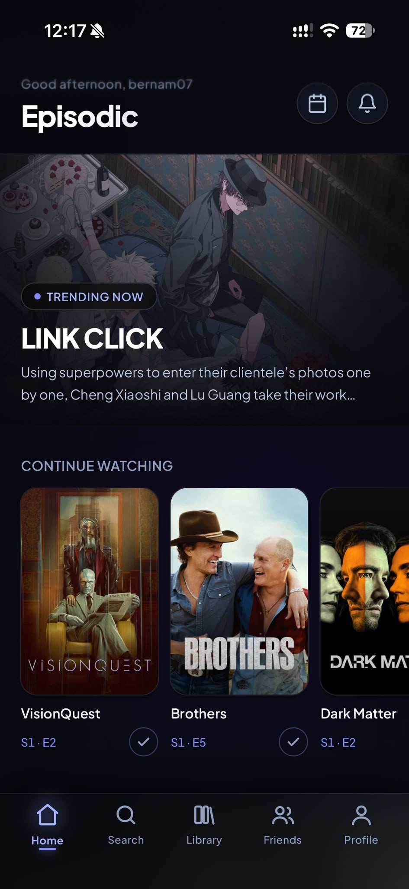
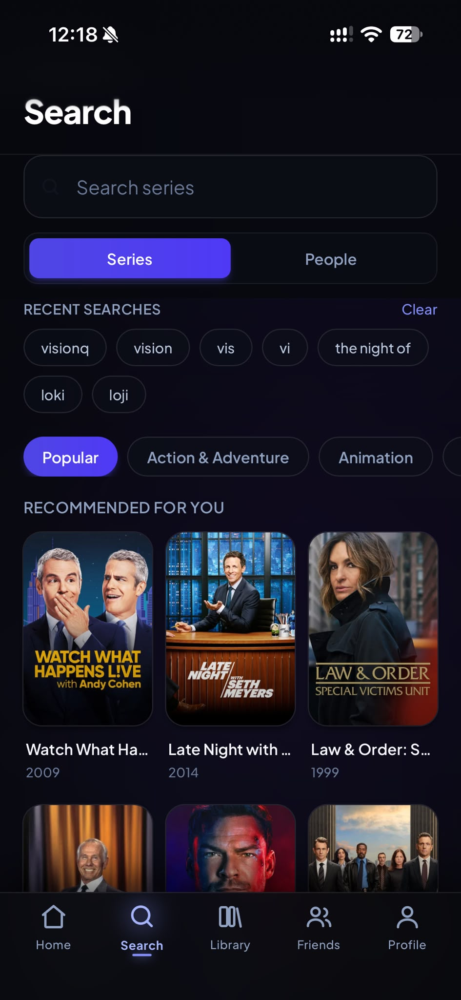
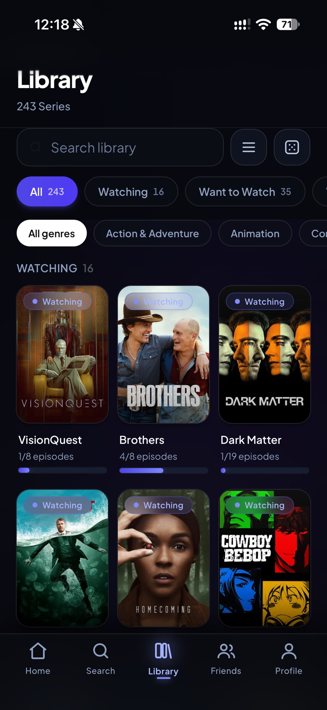
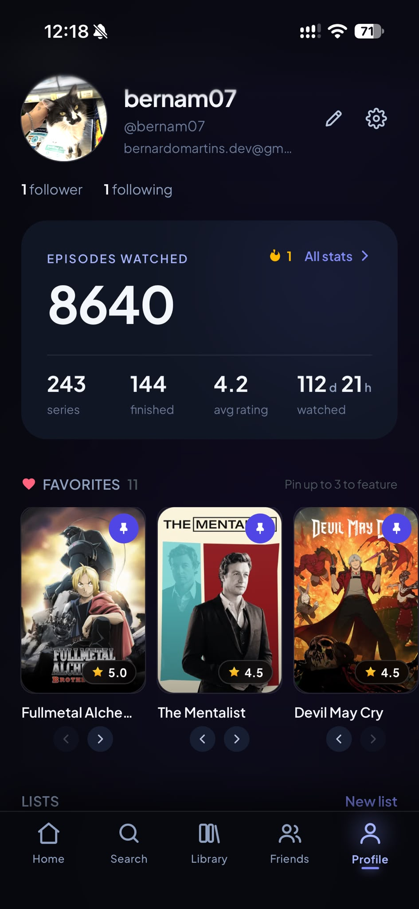

# Episodic

[](https://github.com/bernam07/episodic/actions/workflows/ci.yml)
[](LICENSE)
[](https://react.dev/)
[-blue)](https://www.typescriptlang.org/)
[](https://tailwindcss.com/)
[](https://supabase.com/)

A Letterboxd for television. Track the series you watch, check off individual episodes, rate what you finish, follow what friends are watching, and manage a personal diary. Built as an installable Progressive Web App (PWA) with a mobile-first experience optimized for iPhone viewports and safe areas, fully responsive across tablet and desktop.

| Home | Search | Library | Profile |
| :---: | :---: | :---: | :---: |
|  |  |  |  |

---

## Features

### Discover
- **Hero Highlights** — Promoted series carousel highlighting trending and critically acclaimed television.
- **Genre Browsing** — Filter and explore catalog titles across all major television genres.
- **TMDB Proxy Search** — Low-latency title and cast search powered by the TMDB proxy edge function.
- **Recommendations** — Algorithmic "More like this" suggestions based on series metadata.

### Track & Progress
- **Four Status Tiers** — Organize series into Want to Watch, Watching, Watched, and Abandoned lists.
- **Episode Check-ins** — Mark individual episodes or entire seasons in a single action.
- **Up Next Rail** — Immediate access to the next uncollected episode for all active series.
- **Rewatch Counters** — Track completed rewatches independently from initial logs.
- **Pinned Favorites** — Showcase favorite series directly on user profile headers.

### Watch State Intelligence
- **State Differentiation** — Distinguishes between "up to date" (returning shows where all aired episodes are watched) and "finished" (ended series fully completed).
- **Aired High-Water Mark** — Accurately tracks unaired episodes without false completions.
- **Release Calendar** — Chronological calendar view of upcoming air dates for tracked series.

### Ratings & Reviews
- **Decoupled Half-Star Ratings** — Rate series on a 0.5 to 5.0 scale with support for silent ratings (rating without a public review).
- **Spoiler Management** — Mark reviews with spoiler warnings to preserve viewing experiences.
- **Editable Diary Entries** — Update, refine, or remove past reviews and ratings.

### Social & Lists
- **Activity Feed** — Chronological feed aggregating friends' starts, completions, and reviews.
- **Follow System** — Connect with other users to view their activity and compare viewing habits.
- **Library Comparison** — Direct side-by-side comparison of tracked series and mutual ratings.
- **Curated Lists** — Create public or private themed lists with custom descriptions.

### Insights & Analytics
- **Watch Time Calculation** — Computes total hours and days invested based on recorded episode runtimes.
- **Library Breakdown** — Visual distribution of watching status across all tracked titles.
- **Top Genres & Distribution** — Statistical overview of preferred genres and rating histograms.

### Share & Export
- **9:16 Share Cards** — Generate Letterboxd-style graphic cards with series posters, ratings, and user handles formatted for social stories.

### Push Notifications & PWA
- **Notification Center** — In-app notification inbox for social interactions and releases.
- **Web Push Notifications** — VAPID-based push alerts for new followers, friend reviews, and new episode airings.
- **Installable PWA** — Offline caching, service worker background updates, and standalone home screen execution.

---

## Architecture

Episodic is built with Clean Architecture, enforcing unidirectional dependencies that point inward toward the domain layer. The domain contains business logic and is completely independent of frameworks, databases, and UI libraries.

```
src/
├── core/                 Framework-agnostic primitives, configuration, error types
├── domain/               Pure business logic — zero external framework dependencies
│   ├── entities/         Domain models and pure functions (Airing, Rating, WatchState)
│   ├── repositories/     Interface contracts required by use cases
│   └── usecases/         Orchestration, validation, and domain state machines
├── data/                 Concrete implementations of domain repository interfaces
│   ├── supabase/         Postgres client, RLS queries, Auth, and Storage
│   └── tmdb/             TMDB Edge Function client and image URL formatting
├── presentation/         React presentation layer
│   ├── di/container.ts   Dependency injection root — single location where implementations bind
│   ├── hooks/            TanStack Query hooks wrapping domain use cases
│   ├── components/       Shared presentational components, rails, and UI primitives
│   ├── layout/           App shell, navigation bars, responsive containers, safe-area wrappers
│   ├── router/           Route definitions and authentication state guards
│   └── screens/          Route-level screen containers
└── types/                Supabase generated database schema types
```

### Architectural Enforcement
Architectural boundaries are strictly enforced at build and lint time via Oxlint rules (`no-restricted-imports`):
- `domain` cannot import anything from `presentation` or `data`.
- `presentation` cannot import directly from `data/supabase` or `data/tmdb`. All data access occurs through domain use cases injected via `src/presentation/di/container.ts`.
- Violations produce hard linter and compilation failures.

---

## Design Decisions

- **No `episodes` Table in Postgres**  
  TMDB delivers entire seasons in a single CDN-backed response, which TanStack Query caches client-side. Replicating episode rows into Postgres would introduce data staleness and synchronization overhead. Instead, Postgres stores aggregate episode counts in `series.seasons_meta`. The `user_series_progress` view enables querying entire libraries in a single database round-trip without TMDB calls.

- **Trigger-Driven Status Transitions**  
  Database triggers on `episode_tracking` manage status transitions automatically:
  - Checking the first episode transitions a title to `watching`.
  - Checking off the final episode transitions a title to `watched` and stamps `completed_at`.
  - Unchecking an episode reverts a title to `watching`.
  - `abandoned` status is immutable to triggers and can only be modified through explicit user action.
  - Marking a series "Watched" backfills all aired episodes while preserving unaired episodes for returning seasons.

- **Activity Feed Aggregation**  
  Adding a multi-season series can produce hundreds of episode check-in rows stamped at the same timestamp. The database feed query groups raw check-in records into cohesive milestone events: "started", "finished", "reviewed", and a single summarized "watched N episodes of X" entry per day.

---

## Security and Privacy Model

Episodic has been audited for public open-source publication to ensure zero leakable credentials, robust authorization boundaries, and protection against user enumeration.

### Row Level Security (RLS)
- Every table in the `public` schema has Row Level Security enabled (`ALTER TABLE ... ENABLE ROW LEVEL SECURITY`).
- All insert, update, and delete policies are strictly bounded to `auth.uid() = user_id`.
- Public write access to canonical `series` records is blocked. Series additions occur strictly via security-definer RPC caching after TMDB verification.

### Follower-Gated Library Privacy
User libraries and episode-level check-ins are private by default and visible only to approved followers. Enforced at the database query level:

```sql
using (
  auth.uid() = user_id
  or exists (
    select 1 from follows f
    where f.follower_id = auth.uid() and f.following_id = user_series_status.user_id
  )
)
```

Unfollowing immediately revokes query access to private tracking rows. Aggregate statistics (series count, episode total, review count) are exposed through restricted `SECURITY DEFINER` RPCs without exposing individual tracking records.

### Zero Email Exposure and Anti-Enumeration
- Username-based authentication requires resolving usernames to email addresses. Exposing this via public database RPC would allow bulk email enumeration.
- Authentication takes place inside the `auth-login` Edge Function using the Supabase Service Role key.
- The browser client receives only standard session tokens.
- Authentication errors return an identical `invalid_credentials` message with consistent response timing whether the username does not exist or the password is incorrect.

### Edge Function Authorization Matrix
- `tmdb` — Requires a valid Supabase user JWT (`verify_jwt = true`). Anonymous clients cannot query the TMDB proxy.
- `auth-login` — Public endpoint strictly validating input formatting and sanitizing parameters before service-role lookups.
- `push` — Requires valid user authentication (`verify_jwt = true`) and verifies that the calling user has permission to dispatch notifications.
- `notify-new-episodes` — Protected by a secure `CRON_SECRET` header (`x-cron-secret`) for scheduled cron invocations.

### Database Function Hardening
Every `SECURITY DEFINER` function explicitly specifies `SET search_path = public` to mitigate search-path hijacking attacks.

---

## Responsive & Mobile-First Design

Episodic is built mobile-first with dedicated adaptations for iPhone viewports, Safari PWA constraints, and larger desktop screens.

| Viewport | Navigation | Grid Columns | Modal Style |
|---|---|---|---|
| `< 640px` (Phone) | Fixed bottom navigation bar | 3 columns | Slide-up bottom sheet |
| `640px - 767px` | Fixed bottom navigation bar | 4 columns | Slide-up bottom sheet |
| `>= 768px` (Tablet / Desktop) | Left sidebar navigation | 5-6 columns | Centered modal dialog |

### Mobile Optimizations
- **Safe Area Insets** — Implements `viewport-fit=cover` and CSS `env(safe-area-inset-*)` padding to prevent Dynamic Island and home indicator clipping.
- **Form Zoom Prevention** — Enforces minimum 16px font sizes on input fields to prevent iOS Safari auto-zooming on focus.
- **Touch Feedback** — Active state CSS replaces tap highlights, paired with `overscroll-behavior-y: none` to prevent rubber-banding in standalone PWA mode.

---

## Tech Stack

| Layer | Technology | Details / Purpose |
|---|---|---|
| Frontend Framework | React 19 | UI rendering with latest hooks and compiler optimizations |
| Language | TypeScript 7 (`tsgo`) | Native TypeScript compiler toolchain |
| Build Tool | Vite 8 | Fast build orchestration and PWA asset bundling |
| Styling | Tailwind CSS 4 | CSS-first configuration and dark-mode palette |
| Server State | TanStack Query 5 | Client-side caching, background refetching, and mutations |
| Routing | React Router 7 | Client-side route declarations and navigation guards |
| Database & Backend | Supabase | Managed PostgreSQL 15, Auth, Storage, and Edge Functions |
| External TV Data | TMDB API | Series, seasons, credits, and watch provider metadata |
| Edge Runtime | Deno / Supabase Functions | Server-side TMDB proxy, push dispatch, and username login |
| PWA & Caching | vite-plugin-pwa (Workbox) | Service worker, Web Push handler, and offline asset caching |
| Linter | Oxlint | Fast Rust-based linter enforcing architectural boundaries |
| Testing | Vitest + PGlite | Domain unit tests and WASM-based in-memory Postgres tests |

---

## Getting Started

### Prerequisites
- Node.js 20+ and npm 10+
- A Supabase account and project ([supabase.com](https://supabase.com))
- A TMDB API Read Access Token or API Key ([themoviedb.org](https://www.themoviedb.org/settings/api))

### 1. Clone and Install
```bash
git clone https://github.com/bernam07/episodic.git
cd episodic
npm install
```

### 2. Configure Environment Variables
Copy the example environment configuration:
```bash
cp .env.example .env.local
```

Edit `.env.local` with your Supabase credentials:
```ini
VITE_SUPABASE_URL=https://<your-project-ref>.supabase.co
VITE_SUPABASE_PUBLISHABLE_KEY=<your-anon-publishable-key>
VITE_VAPID_PUBLIC_KEY=<your-vapid-public-key>
```

> The publishable key is safe for client-side inclusion. Never place service-role keys or private credentials into `VITE_*` variables.

### 3. Database and Edge Functions Setup
Follow the complete database provisioning walkthrough in [docs/DATABASE.md](docs/DATABASE.md) to:
1. Link your Supabase CLI (`supabase link --project-ref <PROJECT_REF>`)
2. Push database migrations (`supabase db push`)
3. Set edge function secrets (`supabase secrets set TMDB_ACCESS_TOKEN=...`)
4. Deploy the edge functions (`supabase functions deploy tmdb auth-login push notify-new-episodes`)

### 4. Start Development Server
```bash
npm run dev
```

Open `http://localhost:5173` in your browser.

---

## Available Scripts

| Script | Command | Purpose |
|---|---|---|
| `npm run dev` | `vite` | Starts local development server with HMR |
| `npm run build` | `tsc -b && vite build` | Typechecks and creates optimized production build |
| `npm run preview` | `vite preview` | Previews production build locally |
| `npm run typecheck` | `tsc -b --noEmit` | Runs full TypeScript project reference typecheck |
| `npm run lint` | `oxlint` | Runs Oxlint linter and architectural boundary validation |
| `npm test` | `vitest run` | Runs unit tests and in-memory PGlite database tests |
| `npm run test:watch` | `vitest` | Runs tests in interactive watch mode |
| `npm run test:e2e` | `playwright test` | Runs Playwright end-to-end integration tests |

---

## Testing & Quality Assurance

The test suite covers both frontend application logic and real PostgreSQL database behaviour without requiring a live remote backend:

- **Domain Tests** — Unit tests covering business entities (`Airing`, `Rating`, `Username`, `Email`), calculation logic, and use-case orchestrators using mock repositories.
- **Database Schema Tests via PGlite** — Runs the entire sequence of SQL migrations inside an in-memory Postgres engine compiled to WebAssembly. Validates Row Level Security policies, status triggers, aggregate views, and cascade rules directly within CI.
- **Architectural Linting** — Oxlint enforces import restrictions, accessibility guidelines, and React compiler rules.

---

## Contributing

1. Maintain strict Clean Architecture boundaries: UI components must never import from `data/supabase` or `data/tmdb`.
2. Keep source code free of redundant code comments in `.ts`, `.tsx`, and `.sql` files as per repository conventions.
3. Verify that all checks pass before submitting pull requests:
   ```bash
   npm run typecheck && npm run lint && npm test && npm run build
   ```

---

## License

This project is licensed under the MIT License — see the [LICENSE](LICENSE) file for details.
